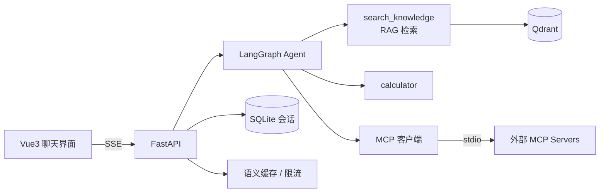

# AI Agent 智能助手平台（Agent + RAG + MCP）

一个可落地的「聊天 → 检索知识库 → 调用工具」智能助手平台。
**Agent 编排**（LangGraph）· **RAG 检索**（Qdrant）· **MCP 双向对接** · **Vue3 聊天界面**。


## 核心能力

| 模块 | 实现 |
|---|---|
| Agent | LangGraph `create_agent` ReAct 循环：自主决定检索/计算/调外部工具，SSE 实时推送工具轨迹 |
| RAG | 上传解析（txt/md/pdf）→ 递归切片 → fastembed 向量化 → Qdrant 检索 → 相似度过滤 → 引用溯源 |
| MCP 客户端 | 常驻连接管理器接入 STDIO MCP Server，JSON Schema 自动转 LangChain 工具，工具即插即用 |
| MCP 服务端 | 知识库检索/文档列表以标准 MCP Server 暴露，Cursor / Claude Desktop 可直接调用 |
| 会话记忆 | SQLite 持久化多轮对话，服务端裁剪上下文，自动标题 |
| 聊天界面 | 流式 Markdown、工具调用时间线、引用卡片、会话侧边栏、知识库上传面板 |
| 工程化 | 语义缓存（向量相似度 0.96）、滑动窗口限流、Docker 多阶段构建 |

## 架构



一次提问的链路：

```
用户消息 → (会话历史) → Agent 决策
             ├─ 调 search_knowledge → 向量检索 → 引用清单
             ├─ 调 calculator / MCP 工具
             └─ 生成回答（流式 delta）
→ SSE: step(工具轨迹) / citations(引用) / delta(文字) / done(耗时/tokens)
→ 会话消息与引用落库
```

## 技术栈

- **后端**：Python 3.10+ · FastAPI · LangChain 1.x / LangGraph 1.x · MCP 官方 SDK 2.x
- **检索**：Qdrant（本地文件模式 / 服务端模式）· fastembed（BAAI/bge-small-zh-v1.5，CPU 可跑）
- **存储**：SQLite（会话）· 进程内语义缓存（可替换 Redis）
- **前端**：Vue 3 + Vite · marked + DOMPurify
- **通信**：SSE（POST + ReadableStream）

## 快速开始

```powershell
cd E:\work\ai-agent-mcp

# 1. 虚拟环境与依赖
python -m venv .venv
.venv\Scripts\Activate.ps1
pip install -r requirements.txt

# 2. 配置（不填 Key 会进入 Mock 演示模式）
Copy-Item .env.example .env
#    编辑 .env：LLM_API_KEY、LLM_BASE_URL、LLM_MODEL

# 3. 启动后端
python -m uvicorn app.main:app --reload --port 8000

# 4. 启动前端（另开终端）
cd frontend
npm install
npm run dev
# 打开 http://localhost:5173
```

- API 文档：http://127.0.0.1:8000/docs
- 健康检查：http://127.0.0.1:8000/api/health

### 生产模式（单进程提供 API + 页面）

```powershell
cd frontend
npm run build
cd ..
python -m uvicorn app.main:app --port 8000
# 打开 http://127.0.0.1:8000/app
```

### Docker 部署

```powershell
Copy-Item .env.example .env    # 填 LLM_API_KEY
docker compose up -d --build   # API + Qdrant
# 打开 http://127.0.0.1:8000/app

# 国内网络构建加速
docker compose build `
  --build-arg PIP_INDEX_URL=https://pypi.tuna.tsinghua.edu.cn/simple `
  --build-arg NPM_REGISTRY=https://registry.npmmirror.com
```

> Docker 文件已提供并做了配置一致性检查；本机未安装 Docker，镜像构建未实测（详见 docs/09）。

## 评测结果

评测集 15 题（11 知识库 + 2 库外拒答 + 2 工具计算），`scripts/evaluate.py` 一键复现：

| 指标 | 结果 |
|---|---|
| 检索 Hit@3 | **100%** |
| MRR | **0.955** |
| 回答关键词覆盖率 | **100%** |
| 引用率 | **100%** |
| 库外拒答准确率 | **100%** |
| 计算准确率 | **100%** |
| 延迟 P50 / P95 | **1.96 s / 2.45 s** |

逐题明细与局限说明见 [docs/10 · 评测与交付](docs/10-评测与交付.md)。

## MCP 双向对接

### 客户端：接入外部 MCP Server

`mcp_servers.json` 声明服务器，启动时自动连接并注册工具（命名 `mcp_<server>_<tool>`）：

```json
{
  "servers": {
    "demo": {
      "command": "python",
      "args": ["mcp_servers/demo_server.py"],
      "agent_tools": true
    }
  }
}
```

内置 demo server 提供 `get_current_time`、`list_sample_files`、`read_text_file`。

### 服务端：把知识库暴露给 Cursor / Claude Desktop

在 MCP 客户端配置中加入：

```json
{
  "mcpServers": {
    "stardust-knowledge": {
      "command": "E:\\work\\ai-agent-mcp\\.venv\\Scripts\\python.exe",
      "args": ["E:\\work\\ai-agent-mcp\\mcp_servers\\knowledge_server.py"],
      "env": { "KNOWLEDGE_API": "http://127.0.0.1:8000" }
    }
  }
}
```

知识库 server 是对平台 API 的薄封装（规避 Qdrant 本地文件锁），**需先启动本平台后端**。

## 项目结构

```
app/
  api/routes/      chat · agent · knowledge · sessions · mcp
  services/        agent · knowledge · llm · sessions · cache · mcp_client
  core/            config · ratelimit
  schemas/         chat · knowledge · sessions · mcp
mcp_servers/       demo_server.py · knowledge_server.py
frontend/          Vue3 聊天界面（Vite）
scripts/           smoke_*.py · evaluate.py
eval/              qa_set.json · report.json
docs/              01~10 教学文档 + 截图
samples/           演示知识库文档
```

## 主要接口

| 方法 | 路径 | 说明 |
|---|---|---|
| POST | `/api/agent/chat` | Agent 流式对话（step / citations / delta / done） |
| POST | `/api/chat` `/api/chat/sync` | 基础 RAG 流式 / 同步对话 |
| POST/GET | `/api/knowledge/upload` `/documents` `/search` | 知识库上传 / 列表 / 检索调试 |
| POST/GET/PATCH/DELETE | `/api/sessions...` | 会话创建 / 列表 / 详情 / 改名 / 删除 |
| GET | `/api/mcp/servers` | MCP 连接状态与工具列表 |

## 路线图

- [x] 第 1 步：项目初始化与最小骨架
- [x] 第 2 步：LLM 接入与流式对话（SSE + Mock 模式）
- [x] 第 3 步：RAG 检索链路（上传→切片→向量化→检索，带引用回答）
- [x] 第 4 步：Agent 引擎（LangGraph ReAct + 工具调用）
- [x] 第 5 步：MCP 客户端（接入外部工具）
- [x] 第 6 步：MCP 服务端（知识库能力对外暴露）
- [x] 第 7 步：会话与记忆持久化（SQLite）
- [x] 第 8 步：前端聊天界面（Vue3 + SSE）
- [x] 第 9 步：工程化（语义缓存 / 限流 / Docker 部署）
- [x] 第 10 步：评测与交付（15 题评测集，全指标 100%）

## 文档

- [01 · 项目初始化与最小骨架](docs/01-项目初始化.md)
- [02 · LLM 接入与 SSE 流式对话](docs/02-LLM接入与SSE流式对话.md)
- [03 · RAG 检索链路](docs/03-RAG检索链路.md)
- [04 · Agent 引擎与工具调用](docs/04-Agent引擎与工具调用.md)
- [05 · MCP 客户端](docs/05-MCP客户端.md)
- [06 · MCP 服务端](docs/06-MCP服务端.md)
- [07 · 会话与记忆持久化](docs/07-会话与记忆持久化.md)
- [08 · 前端聊天界面](docs/08-前端聊天界面.md)
- [09 · 工程化与部署](docs/09-工程化与部署.md)
- [10 · 评测与交付](docs/10-评测与交付.md)
- [附 · Git 基础速查](docs/附-Git基础速查.md)

## 常见问题

| 问题 | 处理 |
|---|---|
| 没有 LLM Key | 自动进入 Mock 模式，可演示链路但回答是固定的 |
| 向量模型下载慢/失败 | `.env` 设置 `HF_ENDPOINT=https://hf-mirror.com`；代码已禁用 HF Xet 后端 |
| Qdrant 本地模式报文件锁 | 确保只有一个进程使用 `data/qdrant`；或配置 `QDRANT_URL` 走服务端 |
| PowerShell 禁止运行脚本 | `Set-ExecutionPolicy -Scope Process Bypass` |
| 反向代理下 SSE 不流式 | 保留 `X-Accel-Buffering: no`，并关闭代理缓冲 |
| 评测/压测被限流 | 调大 `RATE_LIMIT_PER_MINUTE` 或设 `RATE_LIMIT_ENABLED=false` |

## 说明

- `samples/` 中的「星尘科技员工手册」为演示用虚拟资料，内容纯属虚构。
- `.env`、`data/`、`frontend/node_modules/`、`frontend/dist/` 不入库。
- 本项目用于学习与作品展示；生产使用前请补充鉴权、审计与密钥管理。
