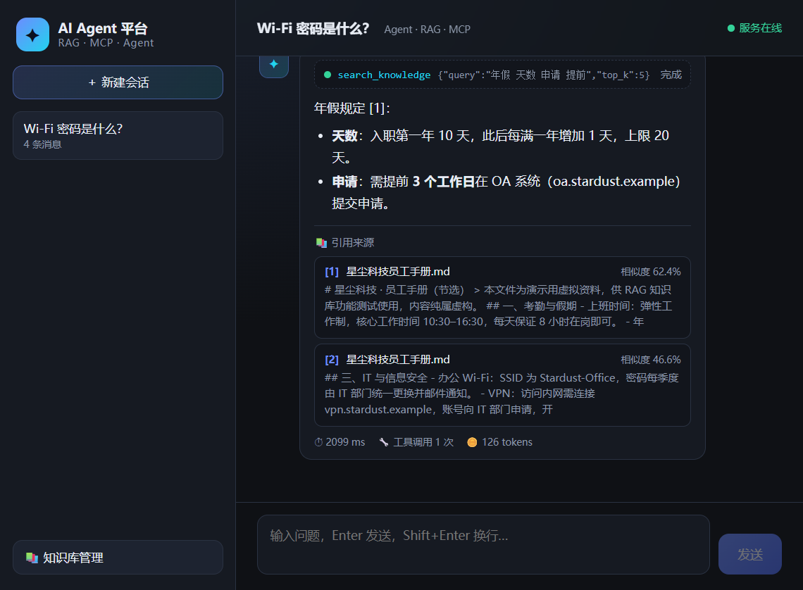

# 08 · 前端聊天界面（Vue 3 + Vite）

> 本步新增：`frontend/`（Vue 3 + Vite 工程）。
> 本步改动：`app/main.py`（构建产物托管到 `/app`）、`.gitignore`（忽略 node_modules/dist）。



## 一、技术选型

| 选择 | 理由 |
|---|---|
| Vue 3（`<script setup>`） | 上手快、体积小；组合式 API 适合流式状态 |
| Vite | 秒级启动、HMR；`/api` 代理解决跨域 |
| 手写 CSS（深色主题） | 不引 UI 框架，样式可控、无额外依赖 |
| marked + DOMPurify | Markdown 渲染 + XSS 清洗（模型输出不可信） |

## 二、核心难点：消费 POST 的 SSE

浏览器的 `EventSource` **只支持 GET**，而我们的对话接口是 POST + JSON。
所以用 `fetch` + `ReadableStream` 手动读流、按帧解析：

```js
const reader = resp.body.getReader()
const decoder = new TextDecoder('utf-8')
let buffer = ''

for (;;) {
  const { value, done } = await reader.read()
  if (done) break
  buffer += decoder.decode(value, { stream: true })
  let m
  while ((m = buffer.match(/\r?\n\r?\n/))) {     // 空行分隔一帧
    const frame = buffer.slice(0, m.index)
    buffer = buffer.slice(m.index + m[0].length)
    dispatch(frame)                              // 解析 event: / data: 行
  }
}
```

注意点：

- **UTF-8 分片解码**：`TextDecoder.decode(value, { stream: true })`，避免一个汉字被拆在两个 chunk 里；
- **缓冲区攒帧**：网络分片不等于事件边界，必须攒到空行再解析；
- **兼容 `\r\n`**：Windows/代理环境可能出现 CRLF。

## 三、事件 → UI 映射

| SSE 事件 | UI 表现 |
|---|---|
| `step`（tool_call） | 工具时间线新增一条"执行中"卡片 |
| `step`（tool_result） | 对应卡片变绿"完成"，可展开看返回摘要 |
| `citations` | 回答下方渲染引用卡片（文件名 / 相似度 / 片段） |
| `delta` | 回答气泡追加文字（打字机效果 + 光标动画） |
| `done` | 底部显示耗时 / 工具调用次数 / tokens |
| `error` | 红色错误提示 |


## 四、状态管理（单文件 App.vue）

```js
messages = [{ role, content, steps, citations, stats, streaming }]
```

- 发送时先插入用户消息 + 占位的助手消息（`streaming: true`）；
- SSE 回调直接修改占位消息的字段（Vue 响应式自动重渲染）；
- 结束后刷新会话列表，拿到后端自动生成的标题与消息数；
- **停止按钮**：`AbortController.abort()` 中断 fetch 流（后端会收到断连并停止生成）。

## 五、会话与知识库

- 侧边栏：会话列表（后端按 `updated_at` 排序）、新建、删除、自动标题；
- 首条消息自动成为标题（后端实现），前端无需额外逻辑；
- 知识库面板：上传（FormData → `/api/knowledge/upload`）、已入库文档列表
  （文件名 + 切片数），上传后自动刷新。

## 六、开发与生产

```bash
# 开发（热更新）：http://127.0.0.1:5173
cd frontend
npm install
npm run dev -- --host 127.0.0.1

# 生产构建：产物 frontend/dist
npm run build
# 构建后重启后端，访问 http://127.0.0.1:8000/app
```

生产模式下 FastAPI 直接托管 `frontend/dist`（`app.mount("/app", StaticFiles(..., html=True))`），
一个进程同时提供 API + 页面，部署最简单。

## 七、实测

```
提问：星尘科技的年假是多少天？需要提前多久申请？
轨迹：search_knowledge({"query":"年假 天数 申请 提前","top_k":5}) → 完成
回答：年假规定 [1]：天数：入职第一年 10 天…上限 20 天；申请：需提前 3 个工作日…
引用：[1] 星尘科技员工手册.md 相似度 62.4%；[2] 同一手册 46.6%
统计：⏱ 2099 ms · 🔧 工具调用 1 次 · 🪙 126 tokens
```

浏览器控制台无报错；历史会话（含引用卡片）在刷新后正常恢复。

## 八、自测题

1. 为什么不能用 `EventSource`？如果非要用它，需要改接口的什么设计？
2. SSE 帧为什么必须用缓冲区攒到空行再解析？直接对每个 chunk 调 `JSON.parse` 会怎样？
3. `TextDecoder` 的 `{ stream: true }` 解决什么边界问题？
4. 前端如何处理"停止生成"？后端需要配合做什么？
